<div align="center">



# Notch Code

**Claude Code and live meeting transcription, living in a notch at the top of your screen.**<br>
Fully local speech recognition · several Claude sessions at once · one small `.exe`

</div>


## Meet Hum

Hum is the little bun with headphones that lives in the notch. The pads of its headphones tell you what's going on:

| Hum | Means |
|---|---|
| eyes shut, pads lilac | nothing going on, the notch stays small |
| pads **red**, sound bars bouncing on them | recording a meeting; the bars get stronger with the voices |
| pads **yellow**, eyes shut | recording paused |
| pads **blue**, eyes scanning, typing dots | Claude is working (orange in *Reckless* mode) |
| pads **cyan**, mouth open | taking a spoken prompt ("Claude, …") |
| **green**, ^ ^ and a few hops | Claude finished |
| frowning, shaking | something failed |

## Open it: everything at a glance

Hover the notch and it opens. The top row has a tab for every place you can go: **Hum** (the overview, Ctrl+H), **Transcribe** (Ctrl+M), one tab per Claude session in its own colour (Ctrl+1…9) and **+** for another folder (Ctrl+T). Ctrl+Tab cycles through them.


The **overview** puts what matters most on the left, with its next step one click away: *Pause / End* while recording, *Watch / Stop* while Claude works, otherwise *Transcribe* or *Ask Claude*. On the right is a tile for the transcriber, for every Claude session (what it's doing right now, or "Done — new reply") and for your recent folders.

## Transcribe


Live meeting transcription (Webex, Teams, Zoom, browser…), fully local: nothing goes to the cloud.

- **Two steps.** The app playing the meeting audio is already picked, so press **Enter** (or the big Start button). Double-clicking any app starts it too.
- **Everything on top while recording.** Hum, the App and Mic levels, the timer, **Pause** (Space) and **End** sit in one row above the transcript. **End** asks for the meeting topic, which becomes the file name.
- **Audio from a single app**: WASAPI *process loopback* capture (only the selected program, not the whole system), plus your microphone if you want (labelled "Me").
- **Local speech recognition**: [whisper.cpp](https://github.com/ggerganov/whisper.cpp) (`large-v3-turbo`, q5_0 quantization) on the GPU via Vulkan.
- **Single exe**: the model (~550 MB) downloads on first launch, with progress shown in the notch.
- Transcripts are saved as Markdown in `Documents\Notch Code`.

## Claude Code

- Pick a project folder, type what you want, Enter. Claude Code runs hidden in that folder, and every step shows up as one plain line ("Editing App.tsx", "Running npm test"); click it for the command and output. Several folders can work at once, each in its own tab. While the notch is closed the bar shows the current step, then "finished".
- **Modes**: *Auto* (Claude decides, risky commands blocked), *Edits* (commands need your OK), *Plan* (read-only), *Reckless* (no permission checks, changes kept automatically). Anything a mode blocks is listed with **Allow and continue**.
- **Terminals**: **Terminal** (Ctrl+`) opens a cmd window in the session's folder. Claude's own shell is hidden, so for anything you should see or that keeps running (a dev server, a watcher, an interactive tool) Claude runs `notch-terminal <command>`, which opens a visible cmd window in that folder. The permission mode still decides whether Claude may run it.
- **Voice**: say "Claude, …" or press the mic button; the prompt is sent when you stop talking.
- **Model** picker (Default / Fable / Opus / Sonnet / Haiku) and the **5-hour limit** (% left, reset time) in the top bar, as reported by Claude.
- **Review changes**: each file is snapshotted before Claude first edits it (a `PreToolUse` hook). Changed files are listed with **Accept** / **Reject** (per file or all); with the notch closed, a pill drops below it with the same buttons. **Live diff** opens every changed file in VS Code as original ↔ current, following Claude's edits live.

## Download

A ready-made `NotchCode.exe` is in **Releases** — every push to `main` publishes a new release (`build-<number>`), the newest one marked *Latest*.

Requirements: Windows 10 2004+ / Windows 11, a GPU driver with Vulkan support (NVIDIA / AMD / Intel), WebView2 (built into Windows 11).

## Where things are

| What | Where |
|---|---|
| Transcripts | `Documents\Notch Code` |
| Model, settings (`config.json`), log | `%LOCALAPPDATA%\Notch Code` |

Folders from the app's former name (`%LOCALAPPDATA%\Transkrypt`, `Documents\Transkrypty`) are moved to the new locations automatically on first launch.

## Start with Windows & updates

- **Start with Windows** — on every launch the app registers a Task Scheduler logon task (`Notch Code`) for the current user, so it starts right at sign-in (no startup-app delay, normal priority). Toggle it from the tray menu (**Start with Windows**) or `autostart` in `config.json`. Local dev builds don't register.
- **Updates** — builds from CI carry their build number. Shortly after launch and every 15 minutes the app checks GitHub Releases for a newer `build-<n>`; if there is one, the notch shows **Update available** with **Update** / **Later**. Nothing is downloaded or installed until you click **Update** (disabled while recording). The new exe is checked (size, SHA-256 from GitHub, PE header), swapped in place and the app restarts. Tray: **Check for updates**. Local release builds count as build 0, so they're offered the newest CI build; `tauri dev` builds never check.

## Claude Code setup

On startup the app looks for the Claude Code CLI (`%USERPROFILE%\.local\bin\claude.exe` or `PATH`) and installs it with the official installer if it's missing (log: `%LOCALAPPDATA%\Notch Code\claude-install.log`).
It checks the sign-in (`claude auth status`) at startup, every 30 minutes and when the notch is opened. When Claude needs to be signed in again, a key icon appears in the notch, the bar says *Claude needs sign-in*, and the panel shows a reminder with **Sign in** (opens the browser) — or **Sign-in window** if the background sign-in can't finish.

`config.json`: `language` (`pl`, `en`, `auto`…), `model`, `use_gpu`, `threads`, `live_preview`.

## Building locally

Requires: Node 22+, Rust (stable), Visual Studio Build Tools (C++), CMake, LLVM, Vulkan SDK.

```powershell
winget install Microsoft.VisualStudio.2022.BuildTools Rustlang.Rustup Kitware.CMake LLVM.LLVM KhronosGroup.VulkanSDK
cd app; npm install; cd ..
powershell -ExecutionPolicy Bypass -File .\app\scripts\build-release.ps1   # -> release\NotchCode.exe
```

Build and swap it in for the copy you use — stops the running app, installs to `%LOCALAPPDATA%\Programs\Notch Code\NotchCode.exe` and starts it (`-SkipBuild` reinstalls the last `release\NotchCode.exe`):

```powershell
powershell -ExecutionPolicy Bypass -File .\app\scripts\deploy.ps1
```

Dev mode: `. .\app\scripts\dev-env.ps1; cd app; npm run tauri dev`.

The animations in this README are plain SVG files in `docs/`, made by `python design/readme_svgs.py` (it takes Hum's styles from `app/src/notch.css`, so rerun it after changing Hum).

## CI

`.github/workflows/build.yml` builds the exe on Windows on every push and PR:

- push to `main` → new release in Releases (`build-<number>`) with `NotchCode.exe`,
- other branches and PRs → build only (exe as an Actions artifact),
- `v*` tag (e.g. `git tag v0.2.0 && git push --tags`) → versioned release with release notes.

## Legal note

Recording and transcribing conversations may require the consent of their participants (GDPR / local law). The user is responsible for lawful use.
