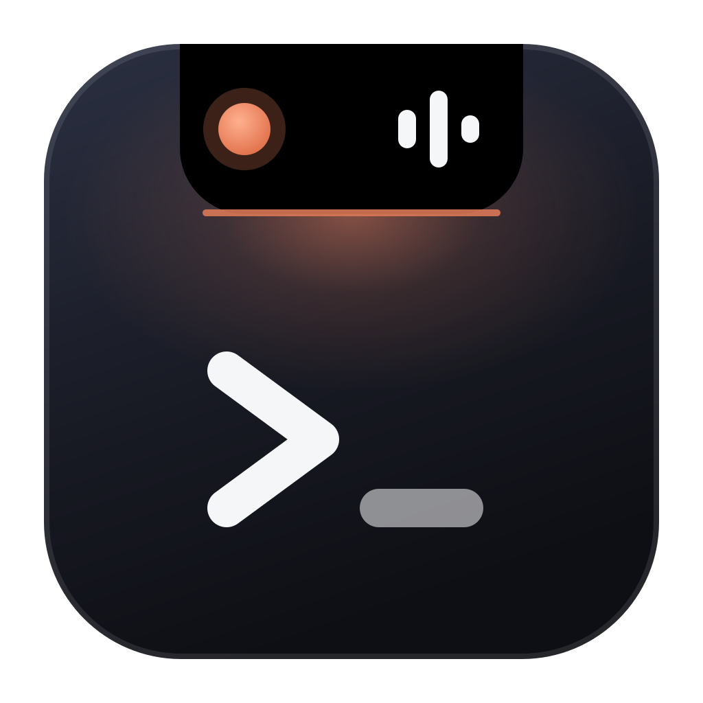

<div align="center">



# Notch Code

**Claude Code and live meeting transcription in a small black island at the top of your screen.**

Fully local speech recognition · several Claude sessions at once · one small `.exe` for Windows



</div>

---

## At a glance

The island sits at the top centre of your screen. Closed, it's a 288 px bar. A status dot sits on the left and each Claude session's colour sits on the right. It only shows text when something needs you:

| The dot | Means |
|---|---|
| grey, breathing slowly | nothing going on |
| **red**, pulsing with the voices | recording a meeting (timer + the last line said) |
| **amber** | recording paused, or Claude needs sign-in |
| **blue**, a ring turning | Claude is working (the bar shows the step it's on) |
| **amber**, a ring turning | Claude is working in **Auto** mode |
| **cyan** | taking a spoken prompt ("Claude, …") |
| **green** | Claude finished while the island was closed (it glows until you look) |
| **red** | something failed |

While something is going on, the bar widens to 440 px and a thin line in the same colour runs along its bottom edge.

## Open it

Hover the island and it grows into a 640 px panel. Its height follows what it shows. The tab row holds the **overview** (Ctrl+H) and the **transcriber** (Ctrl+M). Next come one tab per Claude session in its own colour (Ctrl+1…9) and **+** for another folder (Ctrl+T). Ctrl+Tab cycles through them. On the right are the 5-hour limit, the voice switch, pin, and quit. The limit shows how much of the current session is used (e.g. "37% used"). It's read from Claude Code's own `/usage`, which runs locally and costs no tokens, after every reply and on each sign-in check. Hover it for the week's usage and the reset time.



The **overview** has two cards:

- **Left: what matters most right now, with its next step.** The live transcript with **Pause** / **End**, or the busy session's last steps with **Watch** / **Stop**. Otherwise **Transcribe** or **Ask Claude**. A soft glow at the bottom of the card takes the colour of what's going on.
- **Right: a pill for every place you can jump into.** The transcriber, every Claude session (tinted in its colour, a ring turns while it works, a dot when a new reply is waiting), recent folders, and **New session**.

## Claude Code



- **Pick a folder, type, Enter.** Claude Code runs hidden in that folder. Every step is one plain line ("Editing App.tsx", "Running npm test"); click it for the command and its output. A "Started with N skills" line lists the skills Claude was given; it shows up again only when they change. Several folders can work at once, each in its own tab. Messages you write while Claude works go to it right away, and it reads them at its next step. A `/command` written then waits and runs once Claude finishes. If you stop Claude, everything you wrote for that run comes back into the chat bar.
- **Modes** (Shift+Tab), switchable even while Claude works (it takes effect at once):
  - **Auto**: no permission prompts, every change kept. While it works, the card glows amber.
  - **Edits**: commands need your OK, and changes wait for review.
  - **Plan**: read-only; Claude proposes a plan.

  Anything a mode blocks shows up as a permission card with **Allow and continue**.
- **Model**: Default / Fable / Opus / Sonnet / Haiku, next to the chat bar.
- **Slash commands**: type `/` in the chat bar for the commands Claude Code offers in that folder: your own and the project's (`.claude/commands`, skills), plugins' (`/caveman:caveman-commit`), and built-ins like `/compact` and `/review`. ↑↓ picks, Enter runs, Tab fills it in for arguments. `/clear` starts a new chat and `/model opus` switches the model.
- **Images**: paste them, drop them on the panel, or use the image button.
- **Terminals**: **Terminal** (Ctrl+`) opens a cmd window in the session's folder. Claude's own shell is hidden, so for anything you should see or that keeps running (dev servers, watchers), Claude runs `notch-terminal <command>`. That opens a visible window in the folder, still subject to the permission mode.
- **Voice**: say "Claude, …" or press the mic in the chat bar. The prompt is sent when you stop talking.
- **Review changes**: each file is snapshotted before Claude first edits it (a `PreToolUse` hook). With the island closed, a pill drops below it per project. Hover it for **Reject** / **Diff** / **Accept**. **Diff** opens every change side by side in VS Code.

## Transcribe



Live meeting transcription (Webex, Teams, Zoom, browser…), fully local: nothing goes to the cloud.

- **Two steps.** The app playing the meeting audio is already picked, so press **Enter** (or **Start**). Double-clicking any app starts it too.
- **One row on top while recording**: the source, App and Mic levels, the timer, **Pause** (Space) and **End**. **End** asks for the meeting topic, which becomes the file name.
- **Audio from a single app**: WASAPI *process loopback* capture records only the selected program, not the whole system. Your microphone can be added too, labelled "Me".
- **Local speech recognition**: [whisper.cpp](https://github.com/ggerganov/whisper.cpp) (`large-v3-turbo`, q5_0) on the GPU via Vulkan.
- **Single exe**: the model (~550 MB) downloads on first launch, with progress shown in the island.
- Transcripts are saved as Markdown in `Documents\Notch Code`.

## Download

A ready-made `NotchCode.exe` is in **Releases**. Every push to `main` publishes a new release (`build-<number>`), the newest one marked *Latest*.

Requirements: Windows 10 2004+ / Windows 11, a GPU driver with Vulkan support (NVIDIA / AMD / Intel), WebView2 (built into Windows 11).

## Where things are

| What | Where |
|---|---|
| Transcripts | `Documents\Notch Code` |
| Model, settings (`config.json`), logs | `%LOCALAPPDATA%\Notch Code` |

Folders from the app's former name (`%LOCALAPPDATA%\Transkrypt`, `Documents\Transkrypty`) are moved to the new locations automatically on first launch.

`config.json`: `language` (`pl`, `en`, `auto`…), `model`, `use_gpu`, `threads`, `live_preview`.

## Claude Code setup

All of this happens on its own at startup:

- **The CLI.** The app looks for `claude.exe` (`%USERPROFILE%\.local\bin` or `PATH`). If it's missing, the app installs it with the official installer (log: `claude-install.log`).
- **Caveman.** Once the CLI is there, the app installs the [caveman](https://github.com/JuliusBrussee/caveman) plugin into Claude Code if it's missing (log: `caveman-install.log`). Claude's runs from the island use its **ultra** level (`CAVEMAN_DEFAULT_MODE=ultra`), so answers are short and use far fewer tokens. A **Caveman ultra** badge next to the model shows the level Claude actually answers with: caveman's own hooks report it on every run, and the badge disappears if the plugin is off. If you disable the plugin, it stays disabled.
- **Sign-in.** It's checked at startup (with a one-word Haiku request, since `auth status` alone can't spot an expired session), every 30 minutes, and when the island opens. When Claude needs a new sign-in, the bar says so and the panel shows **Sign in** (opens the browser), or **Sign-in window** if the background sign-in can't finish.

## Start with Windows & updates

- **Start with Windows**: on every launch the app registers a Task Scheduler logon task (`Notch Code`) for the current user. It starts right at sign-in, with no startup-app delay and normal priority. Toggle it from the tray menu or with `autostart` in `config.json`. Local dev builds don't register.
- **Updates**: CI builds carry their build number. Shortly after launch, and every 15 minutes, the app checks GitHub Releases for a newer `build-<n>` and offers **Update** / **Later**. Nothing is downloaded until you click **Update**, which is disabled while recording. Before the swap, the new exe is checked: size, SHA-256 from GitHub, and PE header. Then it's swapped in place and the app restarts. Local release builds count as build 0; `tauri dev` builds never check.

## Building locally

Requires: Node 22+, Rust (stable), Visual Studio Build Tools (C++), CMake, LLVM, Vulkan SDK.

```powershell
winget install Microsoft.VisualStudio.2022.BuildTools Rustlang.Rustup Kitware.CMake LLVM.LLVM KhronosGroup.VulkanSDK
cd app; npm install; cd ..
powershell -ExecutionPolicy Bypass -File .\app\scripts\build-release.ps1   # -> release\NotchCode.exe
```

To swap a fresh build in for the copy you use, run `deploy.ps1`. It stops the running app, installs to `%LOCALAPPDATA%\Programs\Notch Code\NotchCode.exe`, and starts it. `-SkipBuild` reinstalls the last `release\NotchCode.exe`.

```powershell
powershell -ExecutionPolicy Bypass -File .\app\scripts\deploy.ps1
```

Dev mode: `. .\app\scripts\dev-env.ps1; cd app; npm run tauri dev`.

The pictures in this README are animated SVGs in `docs/`, drawn by `python design/readme_svgs.py`. Rerun it after changing the look in `app/src/notch.css`.

## CI

`.github/workflows/build.yml` builds the exe on Windows on every push and PR:

- push to `main` → new release in Releases (`build-<number>`) with `NotchCode.exe`,
- other branches and PRs → build only (exe as an Actions artifact),
- `v*` tag (e.g. `git tag v0.2.0 && git push --tags`) → versioned release with release notes.

## Credits

The island's look (palette, type scale, cards with a glow, pill buttons, chat bar) follows [Coucou](https://github.com/Louis-CFM/coucou) by Louis Raillé, whose code is MIT-licensed. Notch Code uses none of Coucou's name, character, icon or sounds.

## Legal note

Recording and transcribing conversations may require the consent of their participants (GDPR / local law). The user is responsible for lawful use.
